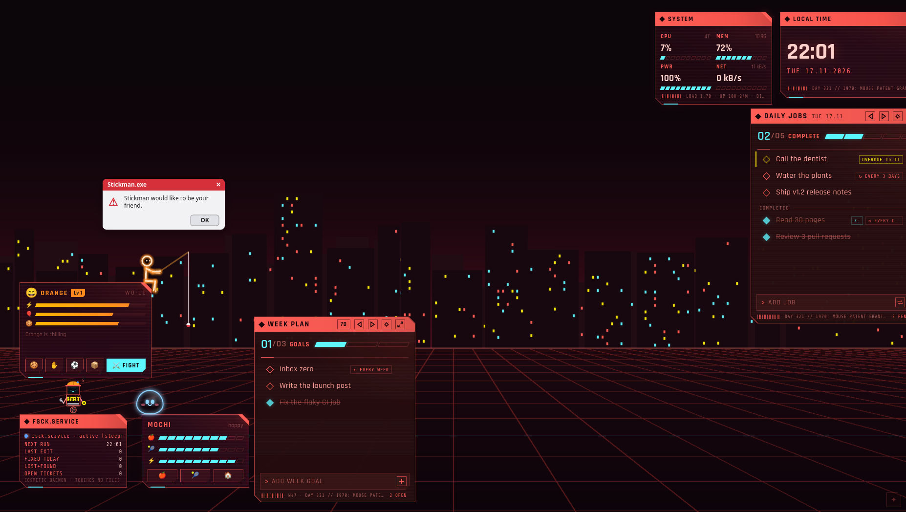
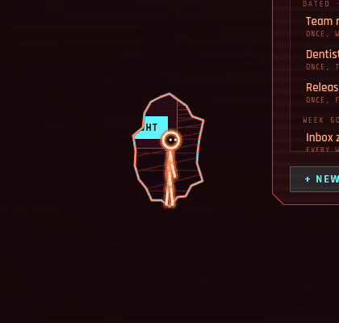
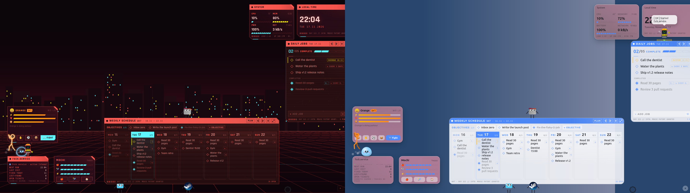

# WidgetSystem

**Desktop widgets that live on your wallpaper, not in your window list.** Glass or neon panels,
a task planner, and characters that walk across your screen, tear full-screen panels like paper
and get patched up by a grumpy repair daemon. Every widget is a small HTML/CSS/JS folder.



- **Not an app you Alt-Tab to.** One transparent layer below all your windows: hidden from Alt-Tab,
  the taskbar and the overview. Clicks on empty space go to your desktop.
- **Themes.** **Night Cron** (default): dark maroon panels, red frames, cyan selection, cut corners,
  with its personality taken from computing culture (cron jobs, daemons, `EXIT 0`, and a daily
  "on this day in computing" line). **Glass**: frosted cards that follow your light/dark setting.
- **Living characters.** They walk on your widgets, sleep, talk, and react to what your computer
  is doing. When a widget goes full screen, they live *behind* it.
- **Run widgets standalone or together.** Every widget repo ships `./run.sh`; inside WidgetSystem
  you install them from the **Navigator**.
- **Hot reload, a small API, no build step.** Write a widget in a folder, save, see it on your desktop.

## The cast

| | |
|---|---|
| **fsck** (built in) | The system's repair daemon, in a hi-vis vest that says `fsck`. It sleeps on its dock until cron wakes it. Then it patches torn panels, seals cracks after fights, moves lost objects to lost+found, offers to restart crashed widgets, and checks your CPU, memory, battery and widget alignment. It speaks in log lines and touches no files. |
| **Mochi** (built in) | A small blob that needs food and fun, follows fsck around "helping", and naps at night. |
| **[DeskSprite](https://github.com/NGdev2/DeskSprite)** | An Animator-vs-Animation stickman. Your installed apps come alive as characters. Draw weapons and fight him. Sometimes he tears his way through your full-screen widgets. |



## Widgets

| | |
|---|---|
| **[CyberTasks](https://github.com/NGdev2/CyberTasks)** | Daily Jobs + Week Plan with routines (every day, days of the week, day of the month, yearly, one date), streaks and carry-over |
| clock, system monitor | built in |
| yours | see [docs/WIDGET_API.md](docs/WIDGET_API.md) |



## Run

```bash
git clone https://github.com/NGdev2/WidgetSystem && cd WidgetSystem
python3 -m widgetsystem          # or: bin/widgetctl start
./install.sh                     # optional: widgetctl on your PATH + start at login
```

You need Linux with X11 (GNOME, Xfce, …), Python 3.10+, GTK 3 and WebKit2GTK 4.1. All of
these come preinstalled on Ubuntu 22.04 and newer. There are no pip packages.

- **✦ button** (bottom right): add widgets, open the Navigator, edit the layout, switch themes.
- **Right-click a widget** for its menu. **Ctrl+drag** moves any widget. **Esc** leaves edit mode or full screen.
- **`widgetctl`**: `list · add <widget>[:variant] · install <id> · theme <id> · send <target> <json> · edit · snapshot out.png · log`

## Writing a widget

```
my-widget/widget.json   {"id": "hello", "name": "Hello", "size": {"w": 220, "h": 120}}
my-widget/main.js       export function mount(ctx) { ctx.root.innerHTML = '<div class="ws-big">Hello</div>' }
```

`widgetctl path add my-widget && widgetctl add hello`, then save to hot-reload. The `ctx` API gives
you:
- frames, storage and settings dialogs
- theme variables and kit parts that look right in every theme
- speech bubbles, particles, and free-roaming overlay elements
- layers, tickets (work orders other widgets can fix), and the actors registry
- system stats and messaging

Full reference: **[docs/WIDGET_API.md](docs/WIDGET_API.md)**. Publish a widget:
[docs/NAVIGATOR.md](docs/NAVIGATOR.md). Ship it standalone: `widgetctl export-solo my-widget`.

## How it works

```
python3 -m widgetsystem
 ├─ server.py     HTTP on 127.0.0.1 · JSON API (token) · server-sent events · widget files
 ├─ registry.py   finds widget folders, hot reload
 ├─ navigator.py  install / update / remove from the widget index
 └─ host_gtk.py   one transparent X11 window: below all windows, skip-taskbar, click-through
                  outside widgets (XShape input region), keyboard focus on click
shell/            the web runtime: frames, themes, layers (back · sheet · front), tickets, effects
themes/           night-cron, glass
widgets/          clock, sysmon, pet (Mochi), fsck
```

The web runtime doesn't know which platform it runs on, so the same shell runs in a normal
browser for development (`widgetctl url`). Porting to Wayland compositors, macOS or Windows means
writing a new host window that loads the same page.

## Why not Conky, Plasma widgets, Eww or AGS?

| Option | What it lacks |
|---|---|
| Conky | Text and graphics only. No real UI or interactivity |
| KDE Plasma widgets | Only work inside Plasma |
| GNOME extensions / Cinnamon desklets | Tied to one desktop, and they break between versions |
| Eww, AGS/Astal, Quickshell | Built on Wayland layer-shell (not supported by GNOME), and aimed at status bars |
| Übersicht, Rainmeter | macOS and Windows only |

Not affiliated with CD PROJEKT RED. The Night Cron theme is inspired by the look of Cyberpunk-style
UIs. Its fonts are Rajdhani and Share Tech Mono (SIL OFL).
