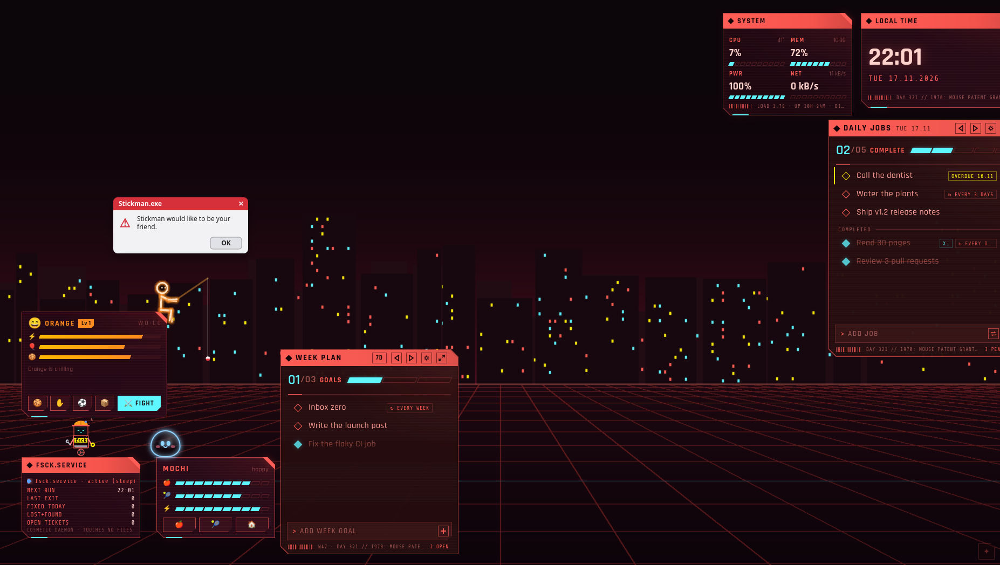
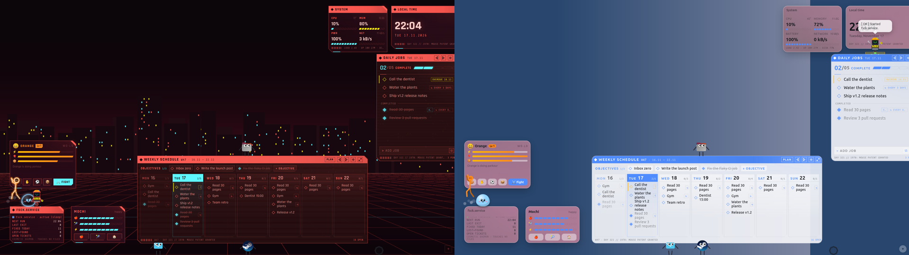
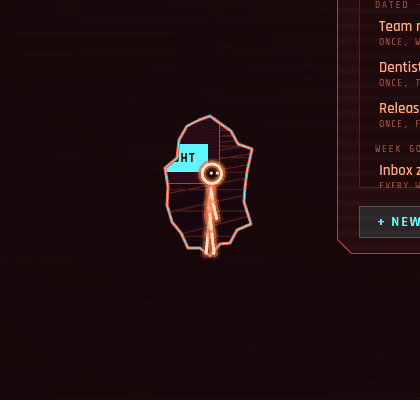
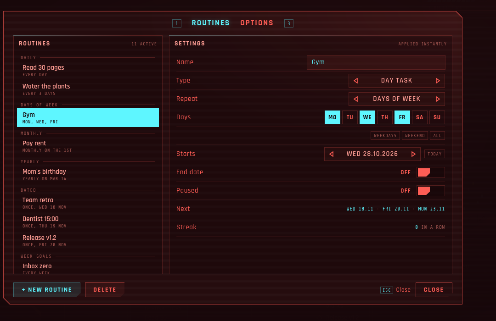

I wanted widgets on my Linux desktop: a clock, my tasks, a little creature. I did **not** want
ten more windows in Alt-Tab. Nothing that exists did what I wanted:
- Conky is text.
- Plasma widgets only work in Plasma.
- Eww and AGS need Wayland layer-shell, which GNOME doesn't have.

So I built **WidgetSystem**: one transparent layer that sits *below* all my windows and above
the wallpaper. It's hidden from Alt-Tab, and clicks on empty space go straight to the desktop.
Every widget is a folder of HTML/CSS/JS.

## The theme: Night Cron

The default theme has dark maroon panels, red frames, cyan selection and cut corners. I didn't
want a straight Cyberpunk copy, so its personality comes from computing culture instead:
- the task widget calls tasks *jobs*, like cron
- finishing your day says `EXIT 0`
- every widget's footer shows a real "on this day in computing" fact. Today:
  `DAY 321 // 1970: MOUSE PATENT GRANTED`

If you prefer soft frosted glass, there's a second theme, and every widget follows it.

## The characters

This is where it got out of hand (in a good way).

- **The stickman** (DeskSprite) is an Animator-vs-Animation-style figure who lives on my widgets.
  My installed apps come alive as little characters with personalities: Foxy the browser,
  Bash the terminal, Binny the trash can, who eats things. I can draw weapons and fight him.
- When a widget goes **full screen**, the characters don't float on top of it any more: they
  live *behind* it. Sometimes the stickman gets bored and **tears the panel like paper** to
  climb through. The hole is real: you see the desktop behind it, and clicks go through it.
- Enter **fsck**, the built-in repair daemon. It wears a hi-vis vest that says `fsck`, has a
  CRT for a face, sleeps on its dock until cron wakes it, and speaks in log lines:
  *"Who tore the panel? …I know who tore the panel."* It diagnoses the hole, lays caution tape,
  stitches, restores the pixels, stamps `EXIT 0`, and then sweeps the paper scraps into lost+found.

It also has a day job:
- it fans the system monitor when the CPU runs hot
- it checks whether the widget you just moved lines up with its neighbours ("off by 3px. Logged.")
- it offers to restart a widget that crashed

It's all cosmetic: fsck works on `/dev/desk` and never touches a file.

## The useful part: CyberTasks

My first real productivity widget:
- **Daily Jobs** for today
- **Week Plan** for the week's goals, with a 7-day view where you drag tasks between days
- **routines** that appear by themselves: every day, Mon/Wed/Fri, the 1st of the month, a yearly
  birthday, one date
- streaks and overdue carry-over

The routines editor looks like a game's settings screen.

## How it works (short version)

- **Python + GTK3 + WebKit2GTK.** One undecorated, transparent X11 window, kept below everything.
  An XShape input region makes it click-through except where widgets are.
- **A tiny local HTTP server** serves the shell and widgets, with a JSON API and server-sent
  events. That means the same shell runs in a normal browser for development.
- **Widgets are ES modules** mounted in shadow roots with a `ctx` API: frames, storage, themes,
  speech bubbles, particles, and free-roaming overlay elements.
- **Layers and tickets.** A "ticket" is a work order any widget can file and any widget can fix.
  A tear is a ticket with a polygon, so the host cuts a `clip-path` hole and enforces the rules:
  - never near your pointer, and never while you type
  - at most three at a time
  - holes mend themselves after 90 s
- **Performance mattered more than I expected.** Every changed frame recomposites a full-screen
  transparent surface, so idle characters stop their animation loops completely, and repaints
  only happen when something visible changes.
- **Every widget runs standalone too:** `git clone … && ./run.sh`. Inside WidgetSystem you install
  them from a VS-Code-style **Navigator**.

## Try it

- WidgetSystem: https://github.com/NGdev2/WidgetSystem
- CyberTasks: https://github.com/NGdev2/CyberTasks
- DeskSprite: https://github.com/NGdev2/DeskSprite

It needs Linux on X11 (GNOME, Xfce, …), Python 3, GTK 3 and WebKit2GTK 4.1, all of which are
preinstalled on Ubuntu 22.04+. Wayland, macOS and Windows hosts are on the list: the web runtime
doesn't know which platform it runs on, so only the host window needs porting.

What widget, or what character, would you put on your desktop?
